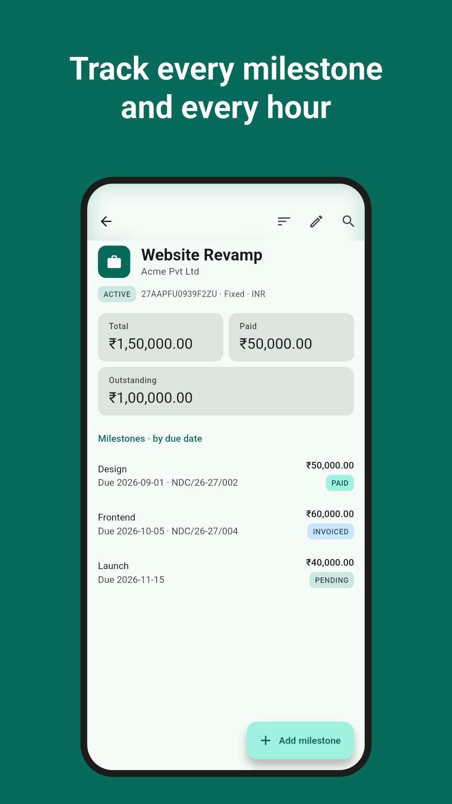
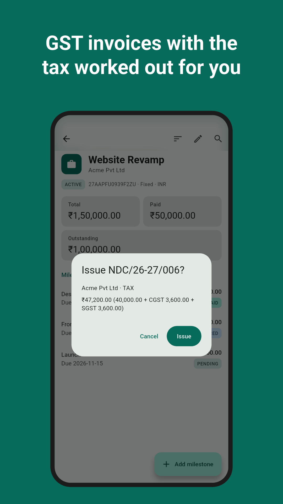
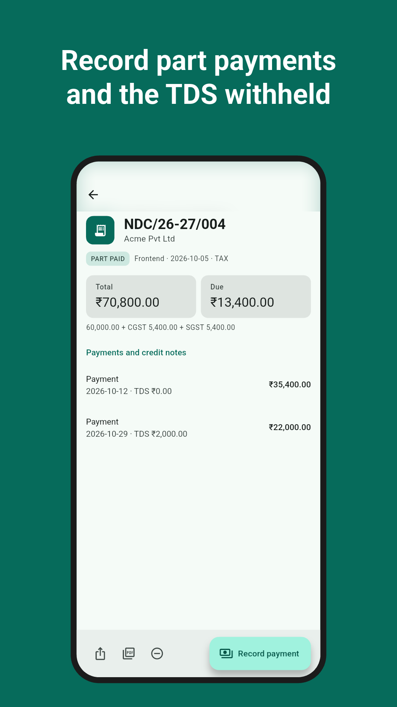
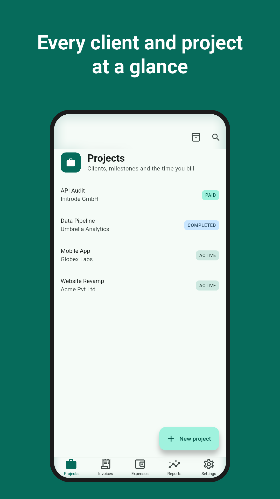
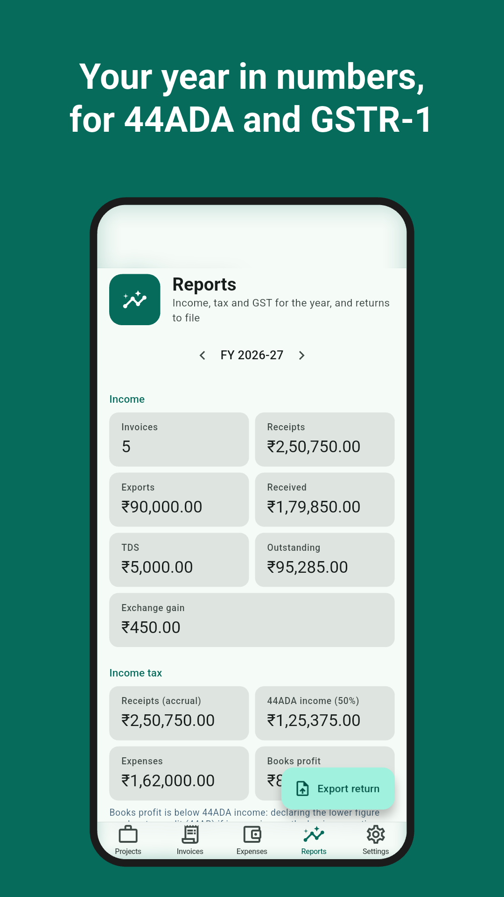
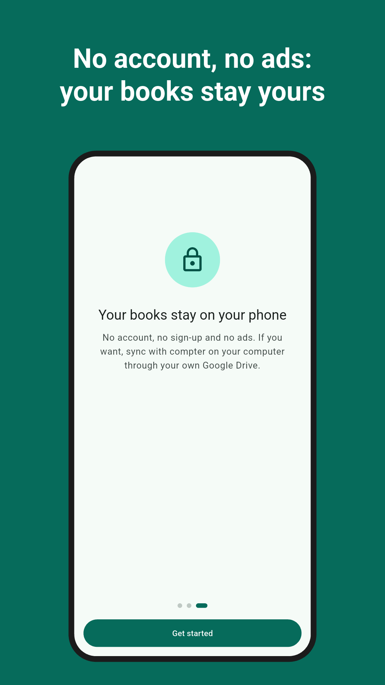
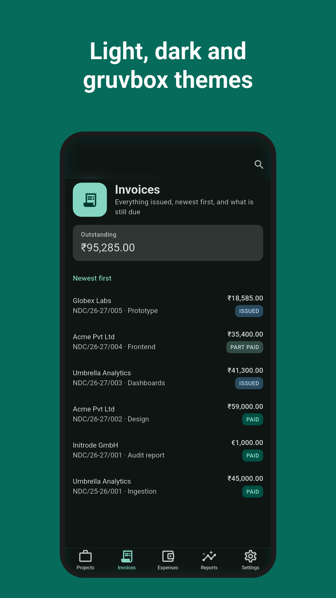

# compter on your phone

The Android and iPhone app keeps the same books as the terminal app: projects and milestones,
GST invoices, payments with TDS, expenses and reports. It syncs with compter on your computer
through your own Google Drive. These are the Play Store screenshots, taken from the demo
business.

<table>
  <tr>
    <td></td>
    <td></td>
    <td></td>
  </tr>
  <tr>
    <td></td>
    <td></td>
    <td></td>
  </tr>
  <tr>
    <td></td>
    <td></td>
    <td></td>
  </tr>
</table>

They are drawn by the app itself; [README.md](README.md) explains how to regenerate them after
a UI change.
